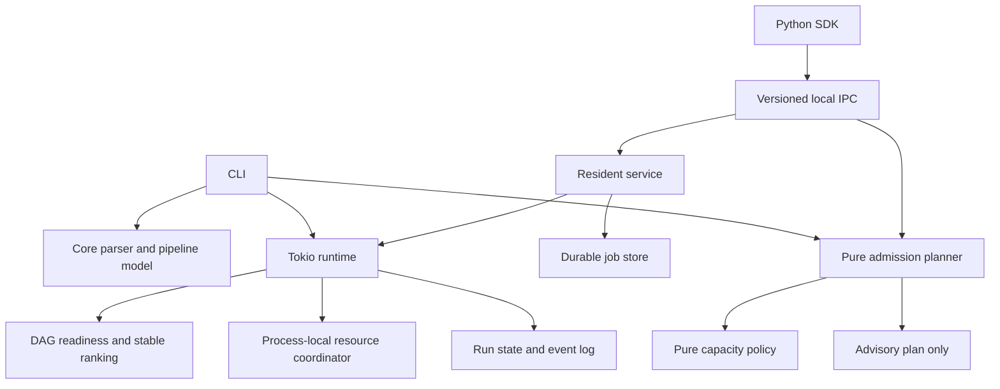
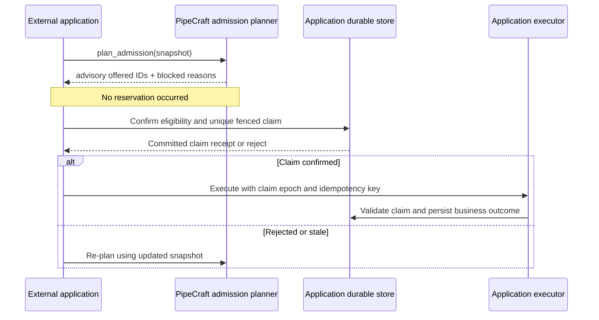

# Architecture and ownership

## Components

`pipecraft-core` parses YAML and JSON-backed inline specs into the same
pipeline model. `pipecraft-graph` enforces dependencies. The runtime uses
Tokio to execute ready nodes, with process-local resource coordination and
persisted DAG status. The service owns job records and IPC request handling.

The new `admission` module has no I/O. Its inputs are an immutable snapshot,
provided capacity signals, existing active claims and fairness history. Its
output is a deterministic proposal. Both DAG ordering and external work
ranking use the same `ranked_ids` implementation, but the external planner is
**not yet connected to the DAG runner's dispatch loop**.

## Safety and domain boundary

The application owns the work record and all side effects. PipeCraft may only
make a selection recommendation until the future confirmed-offer protocol is
implemented and tested. The service's `state.json` is not an application
transaction log. A successful DAG status does not imply that an application's
business operation committed.

## Version compatibility

- YAML: `pipecraft/v1` unchanged.
- IPC: `pipecraft.ipc/v1` unchanged, with additive `plan_admission` request.
- Inline specifications: `validate_spec`, `plan_spec`, `submit_spec` retained.
- Pure module API: new in 1.7, experimental. The return value is advisory.
- No migration of existing persisted jobs is performed automatically.
